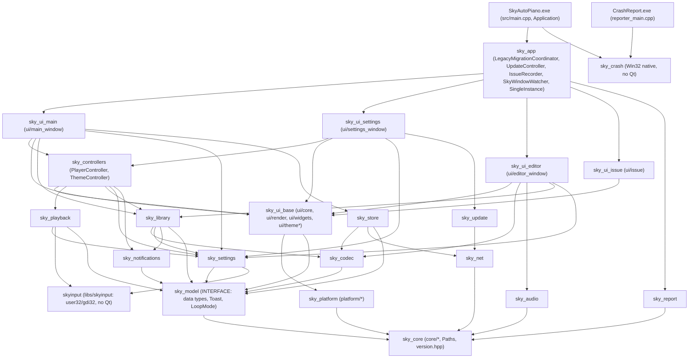

# SkyAutoPianoCpp Architecture

This document defines the mandatory module architecture, dependency rules, and
persistence invariants for **SkyAutoPianoCpp (Sky Auto Piano 2)**. All future
changes must conform to these boundaries; violations are enforced at build time
by CMake target links and checked by repository tests (`tests/repo/test_repository.cpp`).

---

## 1. Architectural Style & Deployment Shape

SkyAutoPianoCpp is a **layered modular monolith** built with C++20 and Qt 6
Widgets for Windows 10/11 x64:

- **`SkyAutoPiano.exe`**: single desktop application executable containing the
  composition root, UI, services, codecs, and input injection.
- **`CrashReport.exe`**: standalone out-of-process Win32 crash reporter
  (`src/crash/`) with **zero Qt dependency**, so crash collection and dialog
  presentation still work if Qt or the main process fails.
- **Forbidden Qt modules** (`cmake/forbidden_qt_modules.cmake`): `Qml`, `Quick`,
  `QuickControls2`, `QuickWidgets`, `WebEngineCore`, `WebEngineWidgets`,
  `WebSockets`, `Sql`, and `Multimedia` are forbidden across all targets.

---

## 2. Layered Target & Dependency Graph

Dependencies are **strictly acyclic (DAG)** and point downward only:

---

## 3. Layer Responsibilities & Strict Boundaries

| Layer | CMake Target(s) | Source Directories | Allowed Dependencies | Forbidden Dependencies |
| --- | --- | --- | --- | --- |
| **Native Input** | `skyinput` | `libs/skyinput/` | Win32 (`user32`, `gdi32`) | Any Qt module, `src/*` |
| **Crash Subsystem** | `sky_crash`, `crashreport` | `src/crash/` | `nlohmann_json`, `miniz`, Win32 | Any Qt module, `sky_core`, `sky_services`, `sky_ui_*`, `sky_app` |
| **Foundation** | `sky_core`, `sky_model`, `sky_codec`, `sky_net`, `sky_platform` | `src/core/`, `src/model/`, `src/codec/`, `src/net/`, `src/platform/` | `Qt6::Core` (and `Qt6::Network` in `sky_net`, `Qt6::Widgets` in `sky_platform`) | `services/*`, `ui/*`, `app/*`, `crash/*` |
| **Service Domains** | `sky_notifications`, `sky_report`, `sky_audio`, `sky_settings`, `sky_playback`, `sky_library`, `sky_store`, `sky_update` (`sky_services` aggregate) | `src/services/<domain>/` | Lower service domains (DAG), `sky_codec`, `sky_net`, `sky_model`, `sky_core`, `skyinput` | `Qt6::Widgets`, `Qt6::Gui`, `app/*`, `ui/*`, `crash/*` |
| **Shared UI Base** | `sky_ui_base` | `src/ui/core/`, `src/ui/render/`, `src/ui/widgets/`, `src/ui/theme*` | `sky_platform`, `sky_model`, `sky_core`, `Qt6::Gui`, `Qt6::Widgets`, `Qt6::Svg` | `services/*`, `ui/controllers/*`, feature windows, `app/*`, `crash/*` |
| **Presentation Controllers** | `sky_controllers` | `src/ui/controllers/` | `sky_ui_base`, required service domains, `sky_model`, `sky_core` | Feature windows, `app/*`, `crash/*` |
| **Feature Windows** | `sky_ui_main`, `sky_ui_settings`, `sky_ui_editor`, `sky_ui_issue` | `src/ui/main_window/`, `src/ui/settings_window/`, `src/ui/editor_window/`, `src/ui/issue/` | `sky_ui_base`, `sky_controllers` (where needed), required service domains | Other feature windows, `app/*`, `crash/*` |
| **App Shell & Entry** | `sky_app`, `skyautopiano` | `src/app/`, `src/main.cpp` | All UI, controller, service, `sky_crash`, `skyinput` targets | N/A (top layer) |

### Key Boundary Rules

1. **No upward or lateral feature-window includes:**
   - Reusable widgets (`src/ui/widgets/`) must never include `services/*` or `app/*`. Shared data structs such as `Toast` and `LoopMode` live in `src/model/`.
   - Feature windows (`main_window`, `settings_window`, `editor_window`, `issue`) must never include headers from each other or from `src/app/`. Shared UI components (`ActionButton`, `ChangelogPanel`, `SettingsRow`, `ThemePreview`) live in `src/ui/widgets/`.
   - Shared runtime facts (`Paths`, generated `core/version.hpp`) live in `src/core/`, not `src/app/`.
2. **Separation of concerns:**
   - **UI** collects intent and renders state; it never owns background migration state machines or performs destructive filesystem mutations outside owning services.
   - **Controllers** (`PlayerController`, `ThemeController`) manage presentation/session state and talk to services through narrow interfaces where needed (`IPlaybackPort` for deterministic testing).
   - **Services** own validation, persistence, and side effects.
   - **`Application`** (`src/app/application.*`) is the composition root, top-level signal wiring, and lifecycle coordinator; legacy migration & cleanup orchestration live in `LegacyMigrationCoordinator` (`src/app/legacy_migration_coordinator.*`, with zero `QWidget` dependencies).
3. **Timing-sensitive playback thread:**
   - Playback timing runs on its own dedicated high-priority thread under `src/services/playback/`. Keep `PlaybackService` behind `IPlaybackPort` and never run UI work on the playback thread.

---

## 4. Data Persistence & Storage Rules

- **Storage root:** `config/`, `data/`, and `logs/` sit next to the executable (overridden by `SKYAUTOPIANO_HOME`). Never change folder names, JSON schemas, or sheet payload formats without an explicit breaking-change decision.
- **Library write order & honesty (`LibraryService` & `PlaylistService`):**
  - Imports write payloads first using shared `ReservationTracker` payload-name reservations (`m_reservedPayloads` guarded by mutex) across concurrent workers, then commit `listSheet.json`. If `listSheet.json` fails, uncommitted payloads created by that attempt are rolled back and failure is reported.
  - Entry edits and metadata-changing note edits (`saveEditedNotes`) write the new payload and new `listSheet.json` before switching in-memory entries or deleting the previous payload.
  - Deletions (`deleteSheet` / `deleteSheets`) share one `DeleteSummary` contract and strictly follow: **(1) commit `listSheet.json` → (2) update `playlists.json` → (3) delete unreferenced payload files**. Never delete a payload while a persisted index or playlist commit has failed.
  - `PlaylistService::save()` returns `Result<void>` and restores the previous in-memory playlists on write failure without emitting `changed()`. Stale `sheetKeys` detected after load are excluded from runtime views and logged without silently rewriting user files.
- **Legacy migration safety:**
  - The old version's data is strictly read-only (`copy` / `selective merge` only).
  - Removal is gated by `LegacyRemovalService` (exact Inno AppId, path isolation, running-process check, fresh verification, and explicit UI confirmation) and invokes the official uninstaller.

---

## 5. Verification & Automated Enforcement

1. **Build-time target graph:** `src/CMakeLists.txt` enforces module edges via distinct CMake targets; forbidden Qt modules fail configuration via `cmake/forbidden_qt_modules.cmake`.
2. **Split test suites (`tests/CMakeLists.txt`):**
   - `skyautopiano_core_tests` links only `sky_services`, `sky_codec`, `sky_core`, `sky_crash`, and `skyinput` (no `Qt6::Widgets` or `sky_ui_*`).
   - `skyautopiano_tests` covers UI, controllers, `LegacyMigrationCoordinator`, i18n parity, and cross-module behavior.
3. **Repository architecture checks (`tests/repo/test_repository.cpp`):**
   - Every `.cpp` under `src/` and `tests/` must be registered in CMake.
   - Every icon ID referenced in UI code must exist in `assets/icons/*.svg`.
   - `source includes respect the layered architecture boundaries` verifies every `#include "..."` under `src/` obeys Section 3.
