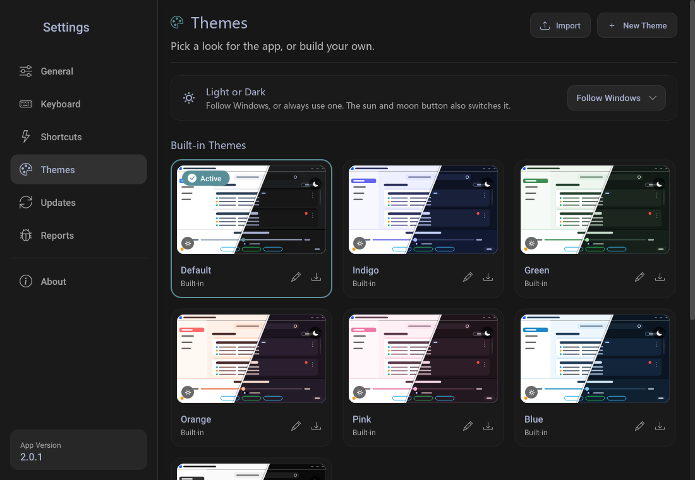

# Themes

Change how Sky Auto Piano looks: pick light or dark, use a built-in theme, build your own, and share
it with friends as a small file.

## Light or dark

By default the app follows Windows. If Windows apps are set to dark, the app is dark, and it
switches by itself when you change the Windows setting.

- Click the **sun or moon** button in the top-right of the player to switch between light and dark.
  The app then stops following Windows.
- To follow Windows again, open **Settings → Themes** and set **Light or Dark** to **Follow
  Windows**. You can also pick **Always light** or **Always dark** there.

> [!TIP]
> Every theme has a light and a dark version, so your theme stays the same when you switch.

## Built-in themes

Open **Settings → Themes** and click a theme to use it straight away. Each preview shows the light
half on the left and the dark half on the right.



| Theme | Look |
| --- | --- |
| **Default** | Clean white and near-black with a teal accent |
| **Indigo** | Soft lavender with an indigo accent |
| **Green** | Pale mint and deep forest green |
| **Orange** | Warm peach with an orange accent |
| **Pink** | Light blossom pink and a dark plum |
| **Blue** | Sky blue and deep navy |
| **Black and White** | Pure black and white with no color at all |

Built-in themes can't be changed, but the **pencil** on any of them makes a copy that you can.

## Build your own theme

1. Open **Settings → Themes** and press **New Theme**. It starts from the look you have now. To
   start from another theme, press the **pencil** on it instead.
2. Give it a name and pick **Editing: Light mode** or **Dark mode**. You build the two versions one
   at a time.
3. Pick the five **Quick Colors**. Each one paints every part of the app that belongs with it, and
   the whole app changes as you go.
4. Open a section under **All Colors** if you want to change one single part.
5. Switch to the other mode and do the same, then press **Save Theme**.

### Quick Colors

The Quick Colors follow the tab you have open in the **Live Preview**:

| Preview tab | Quick Colors |
| --- | --- |
| Songs | Accent, Background, Cards and boxes, Text, Player bar |
| Menus | Pop-up background, Pop-up text, Highlight, Border, Dim |
| Alerts | Success, Warning, Error, Info, Text |
| Settings | Background, Cards, Borders, Descriptions, Switches and Save |
| Editor | Background, Cells, Notes, Highlighted cells, Info panel |

Every color picker supports opacity, so a color can be see-through.

### Live Preview

A small picture of the app sits beside the builder and stays in view while you scroll. It shows the
light and dark version side by side. Point at a color, or open a section, and the preview jumps to
the right screen and lights up the part that color paints.

### Undo, save and cancel

- **Undo arrow:** Puts back the color it had when you started.
- **Undo changes:** Does that for the whole light or dark version you're editing.
- **Save Theme:** Keeps your theme. **Cancel** throws your changes away.
- **Changed count:** Each section under **All Colors** shows how many of its colors you've changed.

### Title bar

On Windows 11 the bar at the top of each window uses the theme's colors too. It follows the window
background unless you set it under **All Colors → Title Bar**. Windows 10 keeps its normal light or
dark title bar.

## Share a theme

- **Export:** Press the **download** button on any theme and save the `.json` file. Send it to
  anyone.
- **Import:** Press **Import** at the top of **Settings → Themes** and pick a theme file. It shows
  up under **Your Themes**.

You can keep up to 100 themes of your own. They're saved in `data\themes.json` next to
`SkyAutoPiano.exe`, so they move with the app.

## Theme file format

A theme file is plain JSON, so you can also write or tweak one by hand:

```json
{
    "format": "sky-auto-piano-theme",
    "version": 2,
    "name": "Night Sky",
    "light": {
        "app.surface": "#f4f6ff",
        "app.text": "#1f2440",
        "app.accent": "#4f6bed"
    },
    "dark": {
        "app.surface": "#10142a",
        "app.text": "#e6e9ff",
        "app.accent": "#8aa2ff",
        "popup.dim": "#00000099"
    }
}
```

- `format` must be `sky-auto-piano-theme`, and `name` can be up to 40 characters.
- Colors are `#RRGGBB`, or `#RRGGBBAA` where the last two digits are the opacity (`00` is clear,
  `ff` is solid).
- Unknown names and broken colors are skipped, so an old theme file still opens in a newer app.

> [!TIP]
> You only need the colors you want to change. Everything you leave out is worked out from
> `app.surface`, `app.text` and `app.accent`, so those three alone already make a full theme.

### Color names

These are the names under **All Colors**, in the same order as in the app.

| Section | Names |
| --- | --- |
| Everyday Colors | `app.surface` base surface, `app.text` text, `app.accent` accent, `app.success`, `app.error` |
| Main Window | `main.window` window background, `main.searchFill`, `main.searchText`, `main.searchIcon`, `main.buttonBorder`, `main.scrollbar` |
| Title Bar | `title.fill`, `title.text`, `title.border` window border |
| Song Cards | `card.fill`, `card.text` title and values, `card.label`, `card.edge` top edge, `card.author`, `card.transcriber`, `card.bpm`, `card.hold` hold badge, `card.menu`, `card.selected` selected outline, `card.favorite` heart, `card.storeTag` |
| Player Bar | `footer.fill`, `footer.text` text and icons, `footer.edge` top edge, `footer.track`, `footer.played`, `footer.handle`, `footer.play`, `footer.skip` previous and next, `footer.buttonFill`, `footer.loop`, `footer.speedFill`, `footer.speedText`, `footer.switch`, `footer.knob` |
| Menu Drawer | `drawer.fill`, `drawer.text` tab text, `drawer.activeStart` active tab, `drawer.selectionBar` |
| Menus and Dialogs | `popup.menuFill`, `popup.menuBorder`, `popup.menuHover` menu highlight, `popup.dialogFill`, `popup.dialogText`, `popup.confirm` confirm button, `popup.dim` shade behind pop-ups |
| Notifications | `toast.success`, `toast.warning`, `toast.error`, `toast.info`, `toast.text` |
| Settings Window | `settings.content` page background, `settings.sidebar`, `settings.sidebarEdge`, `settings.card`, `settings.cardBorder`, `settings.description`, `settings.switch` switch on, `settings.save` save button |
| Sheet Editor | `editor.window` window background, `editor.panel` info panel, `editor.grid` grid lines, `editor.dot` grid dots, `editor.note` notes, `editor.hover` hovered cell, `editor.active` active cell, `editor.export` export button |

## If a theme won't import

- **"The selected theme file is invalid.":** The file isn't valid JSON, `format` is missing or
  wrong, or it has no `name`. Open it in a text editor and compare it with the example above.
- **A color didn't change:** Check that the name is spelled exactly as in the table, and that the
  color has 6 or 8 digits after the `#`.
- **The title bar didn't change:** Title bar colors only work on Windows 11.
