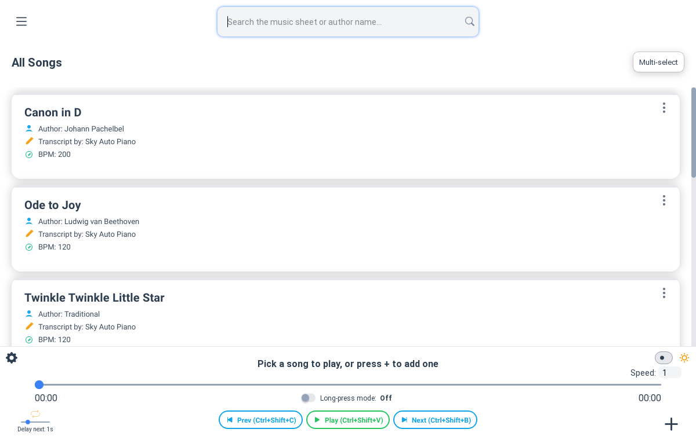
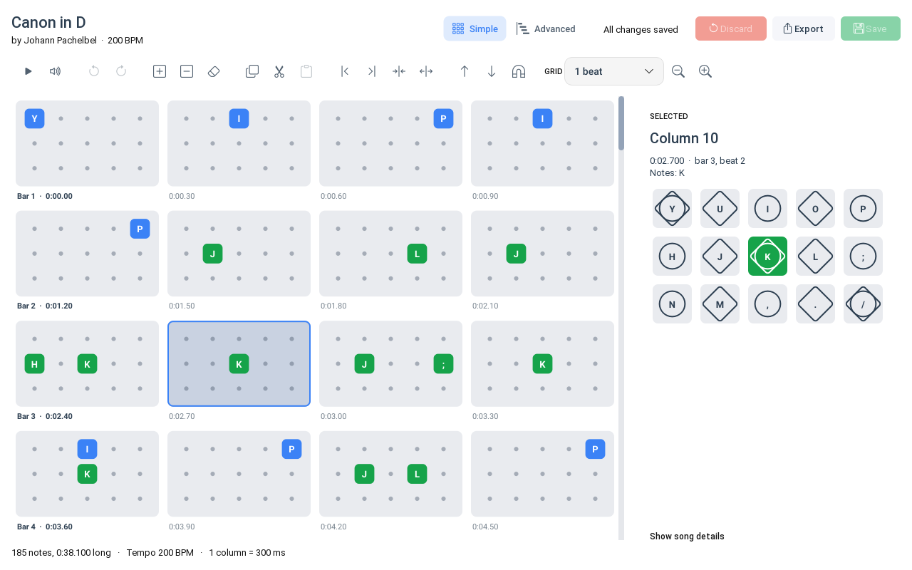
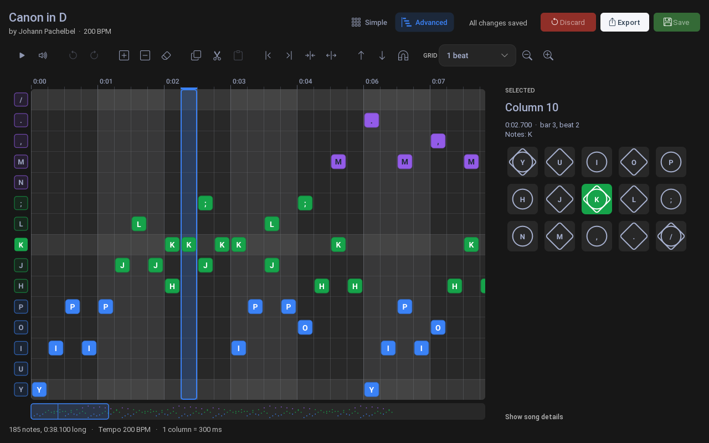

# User guide

A quick tour of everything the app can do. If you haven't installed it yet, start with the [install
guide](INSTALL.md).

## Quick Start

The first time you open the app, a short setup walks you through:

- **Look:** follow Windows, or always light or dark, and pick a theme.
- **Previous version:** the app looks for the original Electron app and offers to import its songs,
  playlists, favorites and settings in one click. If it isn't found, press **Choose folder** and
  pick the old app's folder. Nothing in the old app is changed.
- **Playback:** Lite or Strict, and whether to hide the window when a song starts.
- **Controls:** the global shortcuts for play, previous, next and speed.

Press **Skip setup** to jump straight in. Run it again any time from **Settings → General → Quick
Start**.

## The main window

<picture>
  <source media="(prefers-color-scheme: dark)" srcset="../website/assets/screenshots/library-dark.png">
  
</picture>

- **Top:** The menu button (☰) and the search box. Search looks at song names and authors.
- **Middle:** Your songs, one card each, with the name, author, transcriber and BPM.
- **Bottom:** The player, with the song name, progress bar, speed, long-press switch, loop and the
  **Prev**, **Play** and **Next** buttons.

The menu (☰) switches between **All Songs**, **Favorite**, **Playlists**, **Recent Play** and
**Store**.

## Adding songs

There are three ways:

- Click **+** in the bottom-right corner and pick one or more sheet files (`.json`, `.txt`,
  `.skysheet`, `.mid`, `.midi`).
- Open **Store** from the menu, find a song and download it.
- Copy everything from the original Electron app with **Settings → General → Import Previous
  Songs**.

## Playing a song

1. Click a song card to pick it.
2. Click inside the Sky window.
3. Press <kbd>Ctrl</kbd> <kbd>Shift</kbd> <kbd>V</kbd>, or click **Play**. Press it again to pause.

Pausing keeps your place. To start from somewhere else, pause and click anywhere on the progress
bar.

| Control | What it does |
| --- | --- |
| Speed | How fast the song plays, from 0.1× to 5×. <kbd>Ctrl</kbd> <kbd>↑</kbd> and <kbd>Ctrl</kbd> <kbd>↓</kbd> change it, even while playing. |
| Long-press mode | Holds each key for the length of the note. Turn it on for instruments that hold notes, like the violin. |
| Loop | Click to switch between off, loop the whole list, and loop one song. |
| Delay next | How long to wait before the next song starts. |

### Lite or Strict?

Choose in **Settings → General → Playback Mode**:

- **Lite** is light on your PC, but the timing can drift a little on a busy PC.
- **Strict** has the most accurate timing, but uses more CPU.

> [!TIP]
> If notes sound out of time, try the other one.

## Organizing songs

Each song card has a **⋮** menu:

- **Favorite:** Adds the song to your Favorite list. Click again to remove it.
- **Edit:** Opens the [sheet editor](#the-sheet-editor).
- **Add to playlist:** Puts the song in a playlist.
- **Delete:** Removes the song from your library.

Inside a playlist you can also **Move up**, **Move down** and **Remove from playlist**.

**Multi-select** (top right of the list) lets you tick many songs, then add them to a playlist or
delete them all at once.

**Recent Play** shows the songs you played last, newest first.

## The sheet editor

Open it from a song card: **⋮ → Edit**.

### Choosing a view

Each time the editor opens, it asks two quick questions, with a picture of each choice:

1. **Simple or Advanced view.** Simple shows the song as tiles laid out like Sky's keyboard.
   Advanced shows a timeline with every key on its own row.
2. **Colorful or Plain notes.** Colorful gives each keyboard row its own color (blue, green,
   purple). Plain shows every note in one calm color: white on the dark theme, slate on the light
   theme.

Your last answers are already selected, so you can just press <kbd>Enter</kbd> twice. The arrow keys
switch between the two pictures, and double-clicking a picture picks it straight away.

**Simple view.** One tile per column, shaped like Sky's 3×5 keyboard. Pale tiles are rests.

**Advanced view.** A timeline with one row per key. Blank columns are rests.

### Around the editor

- **Top bar:** The song name, the **Simple / Advanced** switch, whether your changes are saved, and
  the **Discard**, **Export** and **Save** buttons. The editor remembers the view you used last.
- **Toolbar:** Icons for undo and redo, adding, removing and clearing columns, copy, cut and paste,
  playing notes a column earlier or later, holding them shorter or longer, moving them a key up or
  down, snapping to the grid, the grid size and zoom. Hover an icon to see its name and shortcut. It
  works the same in both views.
- **Timeline:** The whole song, left to right. Each row is one key, labelled on the left: the top
  keyboard row in blue, the middle row in green and the bottom row in purple. Every note shows its
  key letter. The strip underneath shows the whole song; click or drag it to jump around.
- **Side panel:** The column you picked, with its time and notes, the key pad, and the song details
  (name, author, transcriber, BPM). Click a detail to change it.

The window opens at a size that fits your screen, and you can resize or maximize it. On a smaller
window the toolbar wraps onto two lines, the key pad shrinks, and the side panel moves under the
timeline. When space is tight, the song details fold away behind **Show song details**.

### Editing notes

- **Add or remove a note:** Click a cell. You can also pick a column, then click a key on the key
  pad or press its keyboard key. In the Simple view, pick a tile, then click a key in it.
- **Move a note:** Drag it. Hold <kbd>Alt</kbd> while you drag to place it between columns. In the
  Simple view, drag the picked tile onto another tile to move its notes there.
- **Hold a note longer:** Drag the end of its bar, or <kbd>Shift</kbd>-drag the note itself.
- **Select columns:** Drag across empty cells or along the ruler, or use <kbd>Shift</kbd> with the
  arrow keys.
- **Grid:** Sets how much time one column holds, from 1 beat down to 1/8 beat. When the editor opens
  a sheet it works out the beat from the notes themselves, so it lines up even when the BPM saved in
  the sheet is wrong.

> [!TIP]
> Some sheets were recorded live and don't follow a steady beat. The editor then leaves every note
> at its exact time and says so in the side panel. **Snap to grid** lines the notes up with the
> columns.

The line under the timeline shows how many notes the song has, how long it is, the tempo, and how
long one column lasts. The editor asks before closing if something isn't saved yet.

### Listening to the song

Press <kbd>Space</kbd>, or the play button at the left of the toolbar, to hear the song from the
selected column. A blue playhead moves through the song, the selected column follows it, and the
keys light up on the key pad. Press <kbd>Space</kbd> again or <kbd>Esc</kbd> to stop. Click a column
while it plays to jump there. You also hear each note as you add it. The speaker button next to play
mutes the sound, and the editor remembers that.

**Soundpack.** The editor plays the Sky piano soundpack that comes with the app. To use your own
sounds, put one file per key in a `soundpack/Piano` folder inside the app's `data` folder, named `0`
to `14`. `0` is the top-left key (Y) and `14` is the bottom-right key (/). MP3, WAV and FLAC all
work, and your files play instead of the built-in soundpack.

### Editor shortcuts

| Shortcut | What it does |
| --- | --- |
| <kbd>←</kbd> <kbd>→</kbd> or <kbd>A</kbd> <kbd>D</kbd> | Previous / next column (add <kbd>Shift</kbd> to select) |
| <kbd>Ctrl</kbd> <kbd>←</kbd> / <kbd>Ctrl</kbd> <kbd>→</kbd> | Jump one bar |
| <kbd>Home</kbd> <kbd>End</kbd>, <kbd>PgUp</kbd> <kbd>PgDn</kbd> | Go to the start / end, or one screen back / forward |
| <kbd>Y</kbd> <kbd>U</kbd> <kbd>I</kbd> <kbd>O</kbd> <kbd>P</kbd> … <kbd>/</kbd> | Add or remove that note in the column |
| <kbd>E</kbd> or <kbd>Insert</kbd> | Insert an empty column after the selection |
| <kbd>Q</kbd> or <kbd>Delete</kbd> | Delete the selected columns and pull the rest of the song forward |
| <kbd>Backspace</kbd> | Erase the notes in the selected columns and keep the time |
| <kbd>Ctrl</kbd> <kbd>C</kbd> / <kbd>Ctrl</kbd> <kbd>X</kbd> | Copy / cut the selected columns |
| <kbd>Ctrl</kbd> <kbd>V</kbd> | Paste at the cursor and push the rest of the song back |
| <kbd>Ctrl</kbd> <kbd>Shift</kbd> <kbd>V</kbd> | Paste on top of the notes already there |
| <kbd>Ctrl</kbd> <kbd>D</kbd> | Duplicate the selected columns |
| <kbd>Alt</kbd> <kbd>↑</kbd> / <kbd>Alt</kbd> <kbd>↓</kbd> | Move the selected notes one key higher / lower |
| <kbd>Alt</kbd> <kbd>←</kbd> / <kbd>Alt</kbd> <kbd>→</kbd> | Play the selected notes one column earlier / later |
| <kbd>[</kbd> / <kbd>]</kbd> | Hold the selected notes one column shorter / longer |
| <kbd>↑</kbd> <kbd>↓</kbd> (Simple view) | Move one row of tiles up / down |
| <kbd>Ctrl</kbd> <kbd>Z</kbd> / <kbd>Ctrl</kbd> <kbd>Y</kbd> | Undo / redo |
| <kbd>Ctrl</kbd> <kbd>A</kbd> | Select the whole song |
| <kbd>Ctrl</kbd> + wheel, <kbd>Ctrl</kbd> <kbd>=</kbd> / <kbd>Ctrl</kbd> <kbd>-</kbd> | Zoom in / out |
| Wheel | Scroll along the song |
| <kbd>Space</kbd> | Play or pause from the selected column |
| <kbd>Ctrl</kbd> <kbd>S</kbd> | Save |
| <kbd>Esc</kbd> | Select only the cursor column |

## Settings

Click the gear in the bottom-left corner. While Settings is open, the global shortcuts are paused so
you can type freely.

- **General:**
  - **Import / Export:** save all your settings to one file, or load them back.
  - **Auto Save Settings:** save changes from the player (speed, long-press and so on) by itself.
  - **Minimize on Play:** hide the app when a song starts.
  - **Playback Mode:** Lite or Strict.
  - **Import Previous Songs:** copy everything from the original Electron app.
  - **Quick Start:** go through the first-time setup again.
- **Keyboard:** If you changed Sky's own keys, turn on **Custom Keyboard** and set the same 15 keys
  here. Press <kbd>Tab</kbd> to jump to the next key.
- **Shortcuts:** Click a shortcut box and press the new keys. Two actions can't share the same keys.
- **Themes:** Pick a look for the whole app, or build your own. See [Themes](#themes) below.
- **Updates:** See your version, **Check Now** for a new one, and turn **Automatic Updates** on or
  off.
- **About:** Links to the original app and this project, and buttons to open your data folder and
  the licence files.

> [!TIP]
> Click the **save** button in the bottom-right corner after changing settings, unless **Auto Save
> Settings** is on.

## Themes

By default the app follows Windows: if Windows apps are set to dark, the app is dark, and it
switches by itself when you change the Windows setting. Click the sun or moon button in the
top-right of the player to pick light or dark yourself. To follow Windows again, open **Settings →
Themes** and set **Light or Dark** to **Follow Windows** (or **Always light** / **Always dark**).

For more looks, open **Settings → Themes**:

- **Built-in themes:** Default, Indigo, Green, Orange, Pink, Blue and Black and White. Each one has
  a light and a dark version, and its preview shows both halves. Click one to use it.
- **New Theme:** Starts a theme from the look you have now. The **pencil** on any theme makes a copy
  you can change.
- **Building a theme:** Choose **Editing: Light mode** or **Dark mode**, then pick the five **Quick
  Colors**: Accent, Background, Cards and boxes, Text and Player bar. Each one colors every part of
  the app that belongs with it, and the whole app changes as you go. Opacity is supported.
- **Live Preview:** A small picture of the app in light and dark sits beside the builder and stays
  in view while you scroll. Its tabs switch between the song list, menus, alerts, Settings and the
  sheet editor. Point at a color, or open a section, and the preview jumps to the right screen and
  lights up the part that color paints. **Quick Colors** follow the screen too: on the Editor tab
  they become the editor's five main colors, on Settings the Settings window's, and so on.
- **Fine-tuning:** Under **All Colors**, open a section (song cards, player bar, menu drawer and so
  on) to change a single part. Each section shows how many of its colors you changed from the theme
  you started with.
- **Undo and saving:** The **undo** arrow next to a color puts back the color it had when you
  started, and **Undo changes** does that for the whole version you are editing. **Save Theme**
  keeps it. **Cancel** throws away your changes.
- **Title bar:** On Windows 11 the bar at the top of each window takes the theme's colors too. It
  follows the window background unless you set it under **All Colors → Title Bar**. Windows 10 keeps
  its normal light or dark title bar.
- **Import / Export:** Share a theme as a small `.json` file.

> [!TIP]
> Want every detail, including how to write a theme file by hand? Read the [Themes
> guide](THEMES.md).

The sun and moon button switches the theme you are using between its light and dark version, and
stops following Windows until you turn **Follow Windows** back on.

## If something goes wrong

If the app crashes, a report is saved in `%LOCALAPPDATA%\SkyAutoPiano\crashes` and you'll see a
message about it on the next start. Please share those files and `logs\skyautopiano.log` when you
[report the problem](https://github.com/NullVoid780/SkyAutoPianoCpp/issues).

More fixes are in the [install guide](INSTALL.md#common-problems). You can also ask on
[Discord](https://discord.gg/Mu8RS9FZky).
